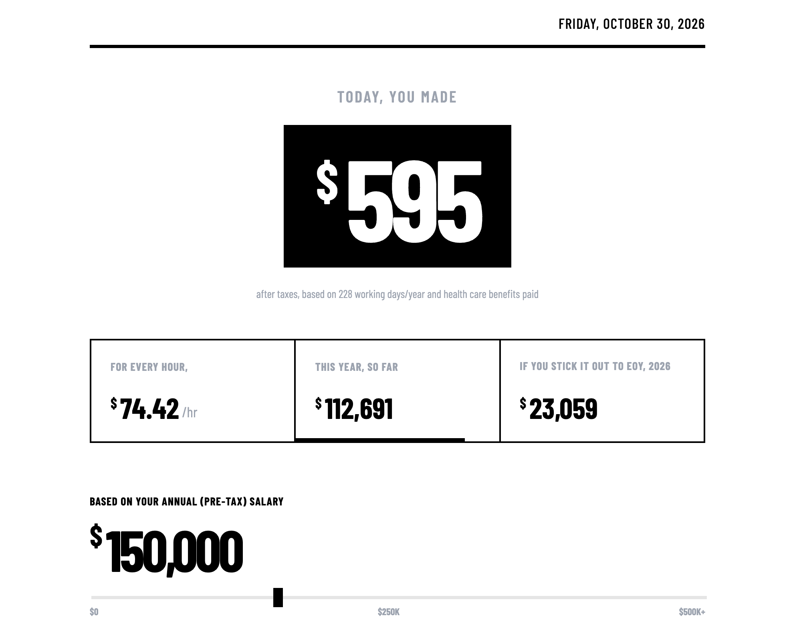
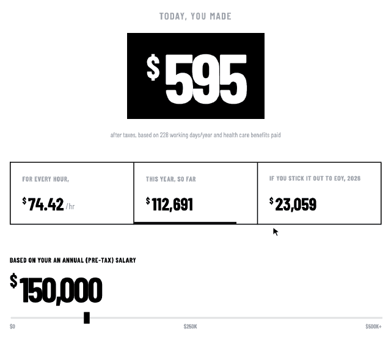
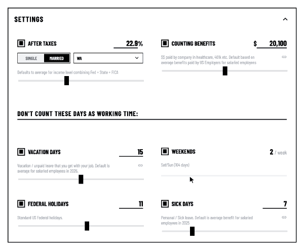
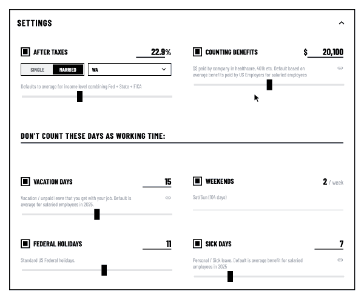
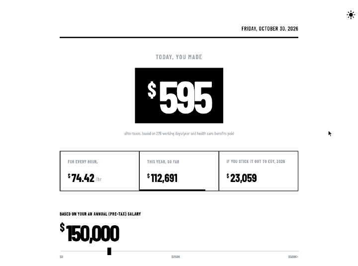

# `made`

How much did you make today? Harder to answer than you'd think. Put in your pre-tax salary and see what you made today, after taxes and with the benefits your company pays counted in.

  
[<kbd> haaans.com/made  </kbd>](https://haaans.com/made)

## Features

<table>
<tr valign="top">
<td width="50%">
<h3>Drag your salary</h3>

Slide the salary and today's number, the hourly rate, the year so far and what's left until December all recount as you go.

</td>
<td width="50%">

</td>
</tr>
<tr valign="top">
<td width="50%">

</td>
<td width="50%">
<h3>Set your taxes</h3>

Pick single or married and your state. The tax rate defaults to the average for your income (federal, state and FICA), and you can drag it to your own.

</td>
</tr>
<tr valign="top">
<td width="50%">
<h3>Leave out the days you don't work</h3>

Vacation, weekends, federal holidays and sick days come off the working year, with defaults from the averages for salaried jobs. Settings stay in your browser until you reset them.

</td>
<td width="50%">

</td>
</tr>
<tr valign="top">
<td width="50%">

</td>
<td width="50%">
<h3>Switch to dark</h3>

The sun in the corner flips the whole page to white on black.

</td>
</tr>
</table>

*made by [hans](https://haaans.com/about)*
